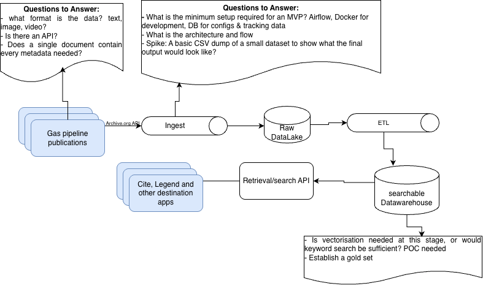

# corpus

Lineage trade-press ingest and authority-ranked RAG search.

Part of [Lineage](https://github.com/line-age/controlplane). What this component takes in,
what it puts out, and what it depends on are described in the controlplane's
[components.md](https://github.com/line-age/controlplane/blob/main/components.md#corpus);
this README will say how it is built once it is.

Work is tracked in the [Corpus](https://github.com/orgs/line-age/projects/2) project. The
team lead is [@FlorenceEgwu](https://github.com/FlorenceEgwu). If that changes, the
[controlplane's table](https://github.com/line-age/controlplane#projects-and-leads) is updated first.

## Architecture



The source is [docs/corpus_sys_diagram.drawio](docs/corpus_sys_diagram.drawio); edit it in
[draw.io](https://app.diagrams.net) and re-export the PNG when the design changes.

## Setup
- Docker (https://docker.com)
- Make

## Running it

```sh
make setup        # build the images; start the API, its Postgres (pgvector) and the ingest database
make db-migrate   # apply migrations, including enabling the vector extension
curl localhost:9001/healthz
make ingest ITEM=sim_oil-gas-journal_1951-06-07_50_5
curl 'localhost:9001/api/v1/search?q=Martin%20County'
```

The first `make` creates `.env` from `.env.example`. With `DOCS_ENABLED=true` (the example
default), interactive docs are at <http://localhost:9001/docs>.

| Target | What it does |
| --- | --- |
| `make help` | List the targets |
| `make setup` | `build`, then `up` |
| `make build` | Build the Docker images |
| `make up` | Start the stack in the background (`docker compose up -d`) |
| `make down` | Stop the stack; the database volume is kept |
| `make test` | Run pytest in a container; pass options with `ARGS="-k health"` |
| `make db-migrate` | Apply Alembic migrations (`alembic upgrade head`) |
| `make lock` | Update `uv.lock` after changing dependencies in `pyproject.toml` |
| `make ingest ITEM=<id>` | Ingest an archive.org item's OCR text; `ARGS="--collection <name> ..."` for collections (see [Ingest](#ingest)) |

Tests use their own databases (`<POSTGRES_DB>_test` and `<POSTGRES_DB>_test_bare`), recreated
on every run, so they never touch development data.

## Ingest

Ingest is being built. The plan is [docs/ingestion-plan.md](docs/ingestion-plan.md).

Only issues dated 1920-1961 are mirrored and indexed; the rest are listed but stop after the
lane stage. The plan explains the window.

```text
src/corpus/             the API
packages/corpus_core/   index format: schema and migrations, collections, lanes, hOCR parsing,
                        normalisation, passages, Internet Archive client, raw store
apps/ingest/            the corpus-ingest CLI: one command per stage
tests/                  API and ingest tests; the ingest end-to-end test needs Postgres
fixtures/               identifier lists for real runs
```

Ingest has its own database, `corpus-ingest-db` (ParadeDB, for `pg_search`), which `make up`
starts alongside the API's. Both share one migration history in `migrations/`, and
`make db-migrate` applies it to both. Ingest needs outbound HTTPS to `archive.org` and
`*.us.archive.org`. Run it in compose (raw files go to the `corpus-raw-data` volume):

```sh
make setup && make db-migrate
docker compose run --rm -v "$PWD/fixtures:/fixtures:ro" corpus-ingest \
  run -c pub_pipeline-gas-journal --ids /fixtures/pgj-sample-15.txt
docker compose run --rm corpus-ingest status
```

or on the host with Python 3.13 and [uv](https://docs.astral.sh/uv/). `CORPUS_DATABASE_URL` in
`.env` already points at `corpus-ingest-db` on `localhost:5433`:

```sh
uv sync
uv run corpus-ingest run -c pub_pipeline-gas-journal --ids fixtures/pgj-sample-15.txt
uv run corpus-ingest export --sample 20 -o review.csv
```

Each stage is also its own command (`enumerate`, `classify`, `lane`, `mirror`, `pages`,
`normalise`, `passages`, `index`). Every one is safe to re-run: items already done are skipped,
failed items are retried up to three times, and finishing a stage for an item resets the stages
after it. `--force` redoes items regardless. Set `CORPUS_TEST_DATABASE_URL` to run the ingest
end-to-end test; without it, that test is skipped.

## Ingest

`make ingest ITEM=<identifier>` downloads an archive.org item's OCR text and stores it, one
row per scanned page, so search results can cite their page. It runs
`python -m corpus.ingestion <identifier> [<identifier> ...]` in the API container.

- The text comes from the item's hOCR derivatives (`_hocr_searchtext.txt.gz` and
  `_hocr_pageindex.json.gz`), which hold the same OCR as `_djvu.txt` but record where each
  page starts. Printed page numbers come from `_page_numbers.json` when the item has one,
  and the title, date, volume and issue from its metadata.
- Each item is written in one transaction. Ingesting an item again replaces its pages, so
  it is safe to repeat.
- It exits 0 when every item succeeded, 1 when any failed and 2 for bad arguments.

Whole collections are ingested with `ARGS`, for example the pre-1920 issues of three
trade journals, 50 evenly spaced issues from each:

```sh
make ingest ARGS="--collection pub_pipeline-gas-journal --collection pub_oil-gas-journal \
  --collection pub_world-oil --to 1919-12-31 --sample 50 --skip-existing"
```

| Option | Meaning |
| --- | --- |
| `--collection <name>` | Ingest the items of an archive.org collection, oldest first (repeatable) |
| `--from` / `--to YYYY-MM-DD` | Only collection items dated within these days, inclusive |
| `--sample N` | Only N items per collection, evenly spaced from its first to its last |
| `--skip-existing` | Leave items already stored alone; repeat an interrupted run to resume it |
| `--concurrency N` | Items downloaded at once, 1 to 16 (default 4) |

Data model (`src/corpus/models.py`): `documents` holds one row per item (identifier,
title, publication date, volume, issue, `source_url`), and `pages` holds one row per
scanned page (`leaf_number`, the 0-based position in the scan; `page_number`, the printed
number or null; and `text`). A trigram index on `pages.text` serves the search filter.

| Setting | Default | Meaning |
| --- | --- | --- |
| `ARCHIVE_ORG_BASE_URL` | `https://archive.org` | Where items are fetched from; document and page links use it too |
| `INGEST_HTTP_TIMEOUT_SECONDS` | `60` | How long each request waits to connect or for more data |

## Search

`GET /api/v1/search?q=<words>` returns every occurrence of a word or phrase, such as a
place name, with a citation for each: the document, the page (printed number, scan
position and a link to that page of the scan) and the statement that contains it.

- `q` is required, 2 to 200 characters. `limit` (1 to 100, default 20) and `offset`
  (default 0) page through the occurrences; `total` counts all of them.
- Matching ignores case, allows any whitespace between words (OCR breaks lines inside
  phrases) and matches whole words only, so `Martin` does not match `Martinez`.
- `match_start` and `match_end` locate the match within `snippet`, for highlighting.
- Results are in corpus order (publication date, then page) by default. With the
  `SEARCH_RANKING_ENABLED` feature flag on, they are ordered by relevance instead: each
  page is scored with BM25, taking the whole phrase as the term, so pages that mention it
  more often, and shorter pages, come first. Every result then carries its page's
  `score`; otherwise `score` is null. `order` in the response says which applies.

| Setting | Default | Meaning |
| --- | --- | --- |
| `SEARCH_RANKING_ENABLED` | `false` | Feature flag: order results by relevance (BM25) instead of by date and page |

```json
{
  "query": "Martin County", "order": "corpus", "total": 3, "limit": 20, "offset": 0,
  "results": [{
    "document": {"identifier": "sim_oil-gas-journal_1951-06-07_50_5", "title": "The Oil & Gas Journal 1951-06-07: Vol 50 Iss 5", "publication_date": "1951-06-07", "volume": "50", "issue": "5", "source_url": "https://archive.org/details/sim_oil-gas-journal_1951-06-07_50_5"},
    "page": {"leaf_number": 148, "page_number": "145", "url": "https://archive.org/details/sim_oil-gas-journal_1951-06-07_50_5/page/n148"},
    "snippet": "Breed- love, northwest Martin County wildcat, some 13 miles northwest of Tarzan, had proved 64 ft.",
    "match_start": 23, "match_end": 36, "score": null
  }]
}
```

Known limits of this first version: abbreviations such as "Co." end a snippet early; a
word hyphenated across a line break in the OCR is not found; and every matching page is
read to count and rank occurrences. Works for this POC - production-grade tooling with ParadeDB's pg_search will be required for full-text search queries (+ stemming) with ranking support.

## Service Status Endpoints

- `GET /` names the service and its version, and links the docs when they are enabled.
- `GET /healthz` reports each dependency (the database, and the pgvector extension in it).
  It answers 200 when all are healthy and 503 when any is not, so it works as a readiness
  probe. Failure details are kept short; the full error goes to the logs.

## Logs

The API writes JSON lines to stdout, one object per record, including uvicorn's own
startup and shutdown messages. Every line has `time` (UTC), `level`, `logger` and
`message`; request lines add `method`, `path`, `status` and `duration_ms`:

```json
{"time": "2026-11-12T15:23:42.861Z", "level": "INFO", "logger": "corpus", "message": "GET /healthz 200 16.5ms", "method": "GET", "path": "/healthz", "status": 200, "duration_ms": 16.5}
```

