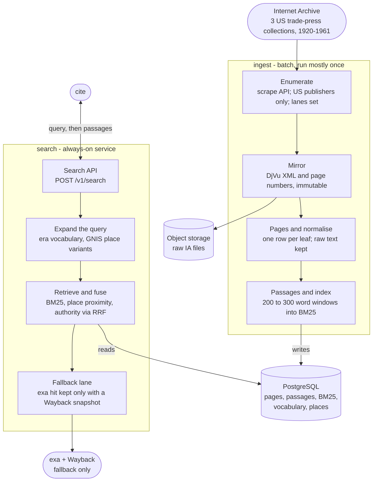
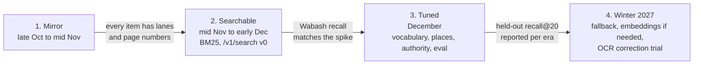

# corpus architecture

How `corpus` is built. What it takes in and puts out is in the controlplane's
[components.md](https://github.com/line-age/controlplane/blob/main/components.md#corpus); this page
does not repeat it. Status: proposed, 2026-10-23.

corpus is two Python deployables over one Postgres database. **Ingest** mirrors the US trade press
from Internet Archive into immutable raw storage and builds a page-level index. **Search** turns place
names, a date window and an attribute into ranked passages whose identifiers resolve on archive.org.

The page is both the retrieval unit and the citation unit. Raw OCR is the text we quote; anything
cleaned is a derived search field. Era vocabulary and authority are versioned data in this repo, not
model behaviour.

## Architecture



Ingest writes the index once and search only reads it. The fallback lane is the one path that leaves
the mirror, and it returns nothing without a snapshot.

## Ingest

Idempotent stages, each reading rows in one state and writing the next, so a run can stop and resume
at any item. A stage table, not a workflow engine (the same idea as L-0003, inside the component).

1. **Enumerate.** List items per collection with the IA scrape API (cursor-paged; advancedsearch caps
   at 10,000). Keep US publishers only; `pub_gas-journal` is the British trade press (Legend 0015).
2. **Mirror.** Per item, `_djvu.xml` (or `_hocr.html`), `_page_numbers.json`, `_djvu.txt`, `_meta.xml`
   to object storage under the IA identifier, with a checksum. Never rewritten.
3. **Record lanes** (I-0006). `license_lane`: pre-1929 `public-domain`; 1929-1961 `public-domain` with
   the renewal reasoning recorded. `retrieval_lane`: `ia-mirror`.
4. **Split pages.** One `page` row per leaf from the DjVu XML: raw text, word boxes, printed page
   number from `_page_numbers.json`. The flat `_djvu.txt` has no page breaks.
5. **Normalise.** A derived search text: rejoin hyphenated line breaks, drop running heads. Spelling
   is left alone; `pipe line` stays `pipe line`.
6. **Passages.** Overlapping windows of about 200 to 300 words with character offsets into the raw
   page text.
7. **Index.** BM25 now. Embeddings later, as a separate re-runnable stage.

Every stage stamps `pipeline_version` on what it writes.

## Storage

| Table | One row per | Key columns |
| --- | --- | --- |
| `publication` | journal run | IA collection, publisher, authority tier, years held |
| `item` | IA issue | identifier, date, volume, number, license lane, retrieval lane, checksums, stage state |
| `page` | leaf | item, leaf, printed page, raw text, search text, word boxes |
| `passage` | window on a page | page, char start and end, search text, BM25 index, embedding (later) |
| `vocabulary` | term in an era | era years, canonical term, variants, attribute, promoted by, version |
| `place` | gazetteer name | name, variants, county, state, point, historical flag (GNIS) |
| `fallback_hit` | exa result | URL, snapshot URL, capture time, text, query |

Scale: about 9,000 issues of about 150,000 words is roughly 1 million pages and 5 to 8 million
passages. BM25 is ParadeDB `pg_search`; vectors are pgvector; the two are merged with Reciprocal Rank
Fusion in SQL. The analyser does not merge compounds, so `pipe line` and `pipeline` stay distinct and
the vocabulary table decides equivalence.

## Search API

`POST /v1/search`

| Request field | Example | Notes |
| --- | --- | --- |
| `places` | `["Noble, Ill.", "Martinsville, Ill."]` | expanded through the gazetteer |
| `date_from`, `date_to` | `1936-01-01`, `1939-12-31` | hard filter on issue date |
| `attribute` | `in_service_date` | selects era vocabulary and authority weights |
| `text` | `8-inch welded` | optional |
| `lanes` | `["ia-mirror"]` | add `fallback:exa` to allow the fallback |
| `limit` | `20` | |

Each result carries `passage_id`, `quote` (raw OCR with `char_start`, `char_end`), `source` (IA
identifier, leaf, printed page, publication, issue date), `url`
(`https://archive.org/details/<id>/page/n<leaf>/mode/1up`, checked to resolve), `lane`, `lineage_key`
(so `cite` can count independent witnesses) and `scores` (BM25, proximity, authority, vector, fused,
`vocabulary_version`). The same results can be emitted as Claude `search_result` blocks.

A query runs: expand places (GNIS variants, spelling drift; never datelines); expand terms for every
era the window touches, returning `vocabulary_gap` when an era has no entry; retrieve with BM25, a
two-place proximity pass (about 1,200 characters, the spike's baseline) and vectors once they exist;
fuse with RRF, authority as its own ranked list; return with every score shown.

Also `GET /v1/pages/{identifier}/{leaf}` and `GET /v1/health`.

## Fallback lane

Only when the caller allows it and the mirror returns too little. Query exa; check the Wayback
availability API; if there is no recent capture, request one through Save Page Now 2 (7 a minute,
30,000 a day authenticated, so through a queue); store original URL, snapshot URL and capture time
(the Robust Links triple); return with `lane = fallback:exa` and the lowest authority. No snapshot, no
result. Keys are runtime configuration, never in the repo.

## Language and tools

| Concern | Recommended | Alternative |
| --- | --- | --- |
| Language | Python 3.12 | |
| Packaging | uv workspace | Poetry |
| IA access | `internetarchive`, `httpx` (async) | |
| XML | `lxml` | `selectolax` |
| Database | PostgreSQL 16+, `pg_search`, pgvector | OpenSearch |
| DB access | psycopg 3, SQLAlchemy Core, Alembic | asyncpg |
| Raw storage | S3-compatible via `boto3`; MinIO in development | local filesystem in tests |
| API | FastAPI, Pydantic v2, Uvicorn | Litestar |
| Stage runner | Typer CLI and a `stage_state` table | Prefect |
| Embeddings (later) | `sentence-transformers`, open model, self-hosted | hosted embedding API |
| Gazetteer | GNIS All Names and Historical Features | World Historical Gazetteer |
| Fallback | `exa-py`, SPN2 over `httpx` | |
| Quality | ruff, pyright, pytest, testcontainers | mypy |
| Observability | structlog, OpenTelemetry | |
| Shipping | Docker images, GitHub Actions | |

`pg_search` is AGPL-3.0. corpus talks to it over SQL and stays MIT (I-0008), but whoever runs Lineage
takes on AGPL terms for the extension. OpenSearch is the alternative behind the same package.

## Layout

```text
corpus/
  packages/corpus_core/   index format: models, SQL, lanes, vocabulary loader (migrations live in the repo-root `migrations/`)
  apps/ingest/            stage CLI
  apps/search/            FastAPI service
  vocabulary/             era tables, YAML, versioned (Legend 0017)
  authority/              publication tiers and per-attribute weights, YAML
  eval/                   gold sets, held-out split, recall@k and MRR
  fixtures/               a few public IA issues for tests
  docs/architecture.md
  Dockerfile              one file, a build target per image (dev, ingest, production)
```

## Evaluation

- Gold sets: Legend's `locate` spike (776 attested items, 145 issues) and the Wabash line (six issues).
  A held-out split is fixed before tuning.
- Metrics: recall@20 per attribute and per era, MRR, share of `vocabulary_gap` responses.
- Baseline: the spike's two-place proximity query.
- CI checks: every `url` resolves against a recorded fixture; every `quote` equals the raw page text
  at its offsets; no non-US publisher indexed; every item has both lanes.
- A new stage (vectors, OCR correction, reranking) ships only if it moves held-out recall.

## Phasing, Fall 2026 (proposed)



## Open decisions

| Decision | Proposed |
| --- | --- |
| BM25 engine | `pg_search`; OpenSearch if AGPL is unacceptable |
| Citation precision | page level |
| Response shape for `cite` | native JSON plus an optional `search_result` view |
| Quoted text | raw OCR only |
| Fallback snapshot | required before return |
| Embeddings | deferred until held-out recall shows a gap |
| 1962-1963 issues | check renewal records per title (the research partner's call) |
| Gold set split | fixed before tuning |
