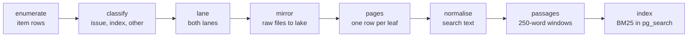

# Ingestion plan

How `corpus` gets the trade press from Internet Archive into a searchable index. Status: proposed,
2026-11-11. Builds on [architecture.md](architecture.md) (lean stack: Typer CLI over a `stage_state`
table, Postgres with `pg_search`, Internet Archive's own OCR).

**Gate:** every in-scope issue mirrored, paged and indexed with both lanes set, by mid-December, with
the Pipeline & Gas Journal run done first as the proof of concept.

**First blocker:** archive.org is not reachable from scripts in the cloud workspace or on dev machines
today. Ingest cannot start until `archive.org` and `*.us.archive.org` are allowed.

## Scope

| Order | Collection | Items | Years |
| --- | --- | --- | --- |
| 1 | `pub_pipeline-gas-journal` | 4,316 | 1859 to 1970s |
| 2 | `pub_oil-gas-journal` | about 2,977 | 1902 to 1961 |
| 3 | `pub_world-oil` | about 1,900 | 1916 to 1961 |

Counts for 2 and 3 are from the Legend spike and are re-counted at enumeration. Out of scope:
`pub_gas-journal` (British, Legend 0015), page images, embeddings, OCR correction, article
segmentation. Post-1961 items are ingested and marked by lane.

## What the 15-issue sample changed

| Finding | What the plan does |
| --- | --- |
| Each issue has `_djvu.txt`, `_hocr.html` (words with confidences) and `_page_numbers.json` | mirror those plus `_meta.xml`; skip `_djvu.xml` |
| 3 of 15 items are annual indexes, 1 is *American Gas Merchandising* | classify item kind; index issues first |
| Index volumes repeat a leaf's text | hash page text; flag duplicates |
| The 1859 issue has no printed page numbers | cite by leaf when no number exists |
| Mean 54 leaves and about 11 MB of text-side files an issue | capacity is about a third of the earlier estimate |

## Stages

Each stage is `corpus-ingest <stage>`: it picks up items in the previous state, does one thing and
records the new state. Only `enumerate` and `mirror` reach Internet Archive; everything later
re-derives from the raw lake.

| Stage | Writes | Done when | On failure |
| --- | --- | --- | --- |
| `enumerate` | `item`: identifier, title, date, volume, issue, publisher, imagecount, data server, files with sizes and checksums | every identifier from the scrape API has a row | retry the cursor page; idempotent on identifier |
| `classify` | `kind`: issue, index, supplement, other | every item has a kind | unknown goes to `other` for a person |
| `lane` | `license_lane`, `retrieval_lane = ia-mirror`, reasoning | every item has both | none |
| `mirror` | `raw/<collection>/<identifier>/` in object storage | files present, checksums match | 3 retries, then `mirror_failed` |
| `pages` | `page`: raw text, mean word confidence, printed page or null, text hash, duplicate flag | page count equals hOCR page count | `pages_failed`; raw untouched |
| `normalise` | `page.search_text` | every page has it | logged per page |
| `passages` | `passage`: 200 to 300 words, 50-word overlap, char offsets into raw text | every non-duplicate page has passages | logged |
| `index` | `pg_search` BM25 index with date, publication, kind, lane filters | row count equals passage count | rebuild from `passage` |

## Capacity

| Store | P&GJ only | All three runs |
| --- | --- | --- |
| Raw data lake | about 33 GB | about 71 GB |
| Postgres `item`, `page` | about 3 GB | about 6 GB |
| Postgres `passage` and index | about 4 GB (1 million passages) | about 9 GB (2.1 million) |
| Not mirrored: PDFs, page images | 90 GB, 0.3 TB | 190 GB, 0.7 TB |

Scaled from 11 sampled issues: mean 54 leaves, 7.7 MB mirrored and about 45,000 words an issue; about
500,000 pages in all. Word boxes stay in the raw hOCR.

## Running it

- **Minimum setup:** a container image, Postgres with `pg_search`, one S3-compatible bucket. No
  Airflow: `stage_state` makes every stage resumable from a Kubernetes Job or a laptop.
- **Development:** Docker Compose with ParadeDB Postgres, MinIO and the CLI; 20 fixture identifiers.
- **Network:** `archive.org` and `*.us.archive.org`.
- **Politeness:** 8 concurrent downloads, a descriptive User-Agent with a project contact, backoff on
  429 and 5xx; tell Internet Archive before the full run.
- **Throughput:** about 7.7 MB an issue, 71 GB in all; a few hours to a day depending on bandwidth.
- **Re-runs:** a parser fix bumps `pipeline_version`; `--stale` re-derives only affected items.
- **Monitoring:** `corpus-ingest status`; failures never block other items.
- **Export:** `corpus-ingest export --sample N` writes a CSV of pages and passages for review.

## Quality checks and gate

- Completeness: every `issue` item indexed or with a recorded failure; failures under 1%.
- Integrity: checksums match; duplicate pages flagged.
- Citability: 50 random passages' archive.org page URLs return 200 and quotes match raw text at offsets.
- Lanes: none missing.
- Search smoke test: Wabash (Noble and Martinsville, 1937) returns its six known O&GJ issues; a
  `gas works` query over the 1880s returns pages a reviewer agrees are relevant.
- Human review: two reviewers score 20 random pages with the sample's `review.csv` rubric.

## Timeline (proposed)

| Milestone | Dates |
| --- | --- |
| Allowlist archive.org | Nov 11 to Nov 18 |
| Scaffold, DB model, fixtures | Nov 16 to Nov 25 |
| Eight stages on fixtures | Nov 23 to Dec 2 |
| P&GJ run and review | Dec 3 to Dec 8 |
| O&GJ and World Oil runs | Dec 9 to Dec 14 |
| Gate: hand index to `cite` | Dec 16 |

## Work breakdown

- [ ] Allow `archive.org` and `*.us.archive.org` (with @sudosume)
- [ ] Write to Internet Archive about the mirror
- [ ] Scaffold uv workspace, CI
- [ ] Docker Compose dev stack
- [ ] DB model and Alembic migrations
- [ ] 20-identifier fixture set
- [ ] `enumerate`, `classify`, `lane`
- [ ] `mirror`
- [ ] `pages` with duplicate hashing
- [ ] `normalise`, `passages`
- [ ] `index` and smoke query
- [ ] `status`, `export --sample`
- [ ] Full P&GJ run, measure, review
- [ ] Size infra-lab Postgres and bucket
- [ ] O&GJ and World Oil runs
- [ ] Gate checks, hand over to `cite`

## Risks

| Risk | Fallback |
| --- | --- |
| archive.org stays blocked | run ingest from a machine that can reach it, writing to the infra-lab bucket |
| Internet Archive throttles | lower concurrency, ask IA, spread runs |
| hOCR missing on some items | `_djvu.xml` for those only |
| `pg_search` unavailable | ParadeDB image, or OpenSearch behind the same package |
| more item kinds than sampled | `other` reviewed before indexing |
| collection counts drift | weekly `enumerate`; identifiers are the key |

## Open questions

- Does the infra-lab offer Postgres with `pg_search` and an S3-compatible bucket? (@sudosume)
- Index annual indexes and *Merchandising*, or keep but exclude?
- Is leaf-level citation acceptable to `cite` when there is no printed number? (@bornakapusta)
- Post-1961 items: lake only, or indexed with lane marked? (the research partner)
- Which contact goes in the User-Agent?
